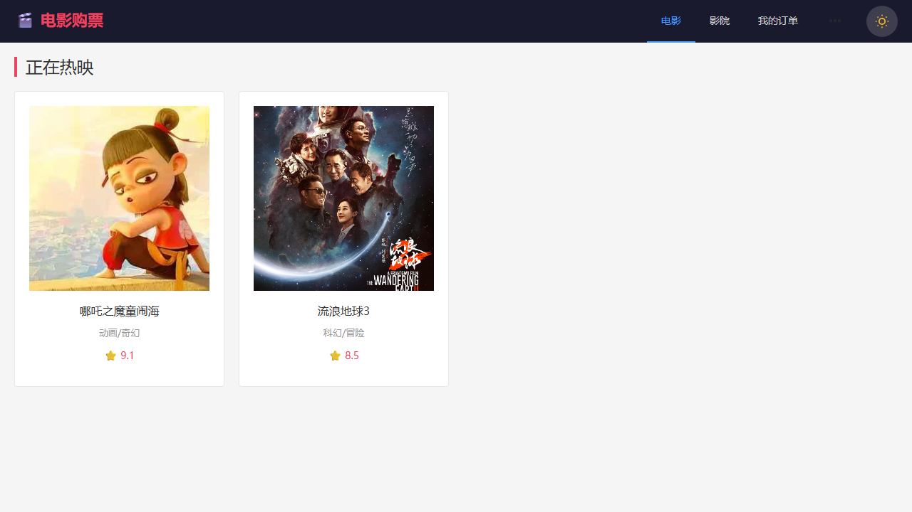
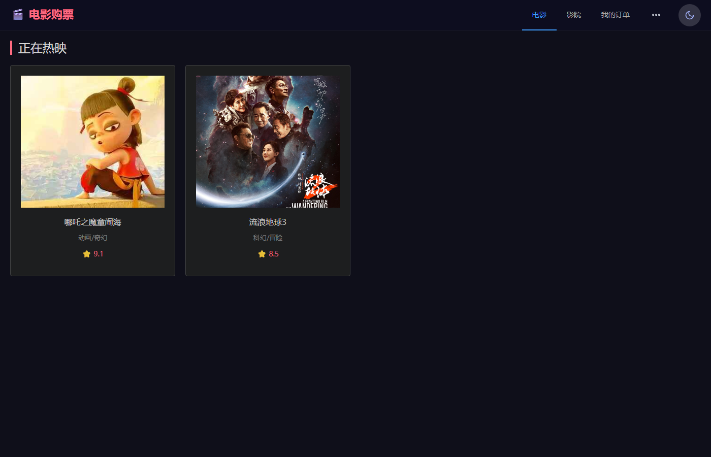
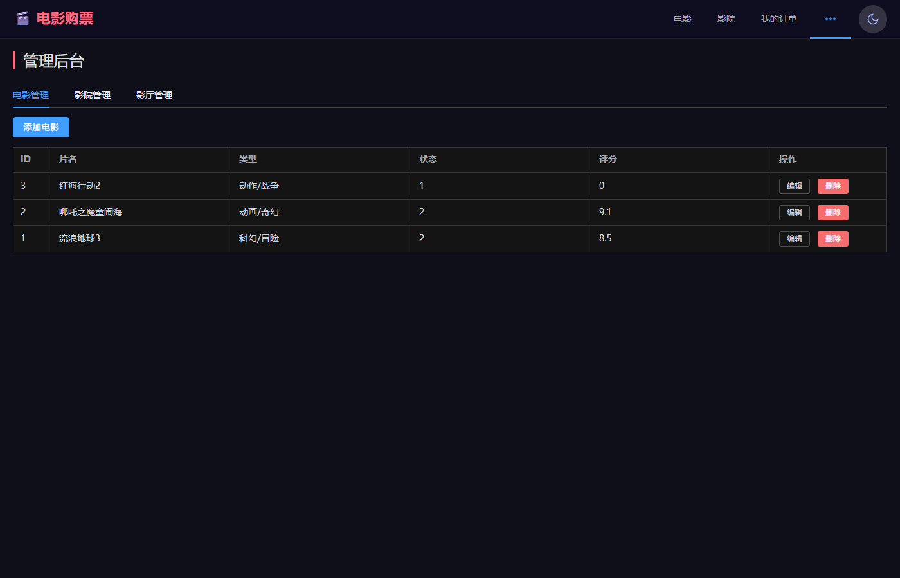

# 🎬 电影购票系统 · Movie Ticket System

基于 **Spring Boot 4 + Vue 3** 的在线电影购票平台，跑通了从「浏览电影 → 查影院/场次 → 可视化选座 → 下单支付 → 订单管理」的完整购票闭环，并配有管理员后台。



## 功能

| 模块 | 说明 |
|------|------|
| 用户 | 注册 / 登录，区分普通用户与管理员 |
| 电影 | 列表、详情，按「正在热映 / 即将上映」筛选 |
| 影院 | 影院列表与详情 |
| 场次 | 按电影 / 影院 / 日期查询排片 |
| **选座** | 可视化座位图，区分「可选 / 已售 / 已选」，实时计价 —— 核心功能 |
| 订单 | 下单、模拟支付、我的订单、取消待支付订单并释放座位 |
| 后台 | 电影 / 影院 / 影厅的增删改查 |
| 界面 | 浅色 / 深色主题切换 |

## 技术栈

| 层 | 技术 |
|----|------|
| 后端 | Spring Boot 4.0.6 · MyBatis 4.0 · MySQL 8 · springdoc-openapi (Swagger UI) · Java 17 |
| 前端 | Vue 3.5 · Vite 8 · Element Plus 2.14 · Vue Router 4 · Axios |

## 快速开始

### 1. 准备数据库

```sql
CREATE DATABASE end_of_term DEFAULT CHARACTER SET utf8mb4;
```

核心 8 张表：`user` / `cinema` / `movie` / `hall` / `screening` / `seat` / `order_ticket` / `order_seat`（另有 `coupon` 优惠券）。
ER 图、字段说明与建表要点见 [`需求.md`](需求.md) 第三节。

### 2. 启动后端

```bash
# 数据库口令支持环境变量覆盖；不设则使用本地默认值 root / 123456
export DB_USERNAME=root
export DB_PASSWORD=你的密码

./mvnw spring-boot:run
```

- 接口地址：<http://localhost:8080>
- Swagger UI：<http://localhost:8080/swagger-ui.html>

首次启动时 `config/DataInitializer` 会写入示例数据（影院、影片、影厅与座位）。

### 3. 启动前端

```bash
cd frontend
npm install
npm run dev
```

打开 <http://localhost:5173>

## 目录结构

```
├── src/main/java/com/example/end_of_term/
│   ├── controller/   7 个 REST 控制器（电影/影院/场次/座位/订单/用户/后台）
│   ├── service/      8 个业务接口 + impl 实现（下单、取消等带事务）
│   ├── mapper/       9 个 MyBatis Mapper 接口
│   ├── entity/       9 个实体
│   ├── common/       Result 统一响应 + 全局异常处理
│   └── config/       CORS 配置、DataInitializer 示例数据初始化
├── src/main/resources/
│   ├── mapper/*.xml  MyBatis SQL 映射
│   └── application.properties
├── frontend/         Vue 3 前端（src/views 为各页面，src/api 为接口封装）
├── docs/             开发实施计划 + 界面截图
└── 需求.md            需求分析 / ER 图 / 表结构 / 接口清单
```

## 关于数据库口令

`application.properties` 里的数据库凭据已改为**环境变量占位**：

```properties
spring.datasource.username=${DB_USERNAME:root}
spring.datasource.password=${DB_PASSWORD:123456}
```

冒号后面是本地开发用的默认值，生产部署请务必通过环境变量注入。

## 截图

| 电影列表（深色） | 管理后台 |
|---|---|
|  |  |

## 文档

- [`需求.md`](需求.md) —— 需求分析、ER 图、表结构、接口清单与实现步骤
- [`docs/实施计划.md`](docs/实施计划.md) —— 开发实施计划
